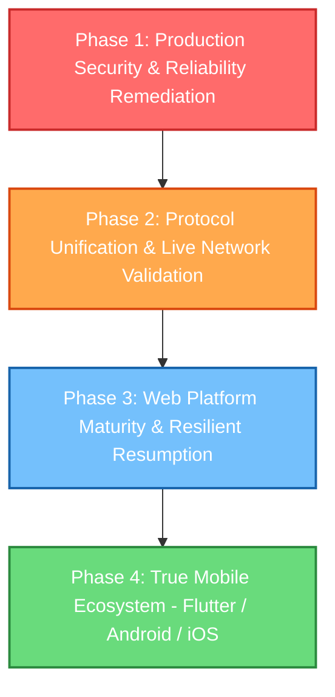

# LAN-Drop: Strategic Next-Phase Roadmap (Post-Audit)

**Date**: 2026-11-10  
**Status**: Strategic Proposal  
**Authors**: Chief Software Architect, Technical Lead, QA Lead, Security Lead  
**Governing Philosophy**: **Transfer-First, Security-First, Zero-Telemetry, Real-World Verification**

---

## 1. Executive Summary & Strategic Phasing

The Production Readiness Audit demonstrated that while LAN-Drop has achieved remarkable architectural milestones (C++20 modular core, lightweight Go signaling server, zero-dependency STUN/QR tools, and offline LAN transfers), **it cannot proceed to public release or mobile application development until critical protocol, security, and verification blockers are remediated**.

Building a Flutter mobile app on top of a protocol-divergent core with a deadlocked C-ABI bridge would compound technical debt.

Therefore, the roadmap is organized into **four sequential, dependency-aware phases**:



---

## 2. Phase Breakdown & Detailed Specifications

### Phase 1: Production Security & Reliability Remediation (Immediate / Sprint 1)
- **Goal**: Eliminate operational defects that cause production outages or security vulnerabilities.
- **Priority**: **P0 (Absolute Blocker)**
- **Dependencies**: None.
- **Estimated Effort**: 3–5 Engineering Days.
- **Complexity**: Moderate.

#### Scope of Work:
1. **Fix Coturn Shared Secret Synchronization (`SEC-02`)**:
   - Update `docker-compose.yml` to pass `TURN_SECRET=${TURN_SECRET}`.
   - Update `backend/signaling/cmd/server/main.go` to inspect `COTURN_STATIC_AUTH_SECRET` if `TURN_SECRET` is unset.
   - Verify Coturn accepts minted credentials under simulated NAT.
2. **Eliminate Global Rate-Limiter Blackout (`SEC-03`)**:
   - Add `TRUST_PROXY=true` flag in `main.go` and `docker-compose.yml`.
   - Update `extractClientIP()` to correctly trust `X-Forwarded-For` from Caddy.
   - Prevent 5 failed attempts from blocking the reverse proxy IP.
3. **Bound Rate Limiter Memory & Prevent Lock Starvation (`SEC-04`)**:
   - Replace linear scan in `limiter.go` with a strictly bounded LRU eviction cache (capacity 50,000 entries).
   - Eliminate $O(N)$ mutex contention under IP flood attacks.
4. **Fix Mobile Bridge Worker Deadlock (`DEF-MOB-01`)**:
   - In `LandropMobileBridge.cpp:350-366` and `427-443`, move `ctx->transferWorker` out of `ctx->mutex` lock scope before invoking `.join()`.
5. **Task-Unique Staging Paths (`SEC-05`)**:
   - In `TransferEngine.cpp:597`, change staging path from `<fileName>.part` to `.<fileName>.<taskId>.part`.
   - Prevent pre-existing `.part` file deletion and concurrent transfer collisions.
6. **Fix Fedora RPM Build Error (`DEF-OPS-03`)**:
   - Add `%{_datadir}/metainfo/*.xml` to `%files` in `packaging/fedora/landrop.spec`.
   - Add post-install desktop/icon cache scriptlets.

#### Acceptance Criteria:
- `docker-compose up` launches Caddy, Coturn, and Signaling with 100% functional STUN/TURN authentication.
- Rate limiter stress test (100,000 requests from distinct IPs) stays strictly bounded in memory without mutex timeouts.
- Mobile bridge test suite runs without thread deadlocks.
- `rpmbuild` on Fedora 41 completes with 0 errors.

---

### Phase 2: Protocol Unification & Live Network Validation (Sprint 2)
- **Goal**: Integrate Wire Protocol v2 into Desktop C++ `TransferEngine` to achieve 100% interoperability with Web and eliminate the mock WebRTC test illusion.
- **Priority**: **P0 (Blocker for Cross-Platform)**
- **Dependencies**: Phase 1.
- **Estimated Effort**: 7–10 Engineering Days.
- **Complexity**: High.

#### Scope of Work:
1. **Integrate WireProtocolV2 into `TransferEngine` (`DEF-ENG-01`)**:
   - Refactor `TransferEngine::sendFileOverChannel` to serialize 16-byte `LNDP` binary frame headers, `FileHeaderMessage`, and `ChunkDataMessage`.
   - Refactor `TransferEngine::receiveFileOverChannel` to parse incoming `LNDP` frames with CRC-32 integrity validation.
   - Implement backward-compatible handshake to allow automatic fallback to Protocol v1 when talking to legacy LAN-Drop v1.0.0 desktop nodes.
2. **Automated Real WebRTC E2E Test Suite (`DEF-QA-02`)**:
   - Add automated test in Suite 26 that initializes two real `rtc::PeerConnection` instances on loopback with STUN disabled.
   - Exchange real SDP offers/answers and ICE candidates over the live Go signaling server binary.
   - Stream a real 10 MB and 100 MB file over real SCTP data channels without `mockLoopbackMode`.
3. **Decouple `landrop_core` from Qt Framework**:
   - Remove UI Presenters (`DiscoveryPresenter`, `TransferPresenter`) and `QrCodeGenerator` from `landrop_core` target in `CMakeLists.txt`.
   - Guard Qt Network headers in POSIX networking fallbacks so `landrop_core` can build as a pure C++20 static library with zero Qt dependency.
4. **Single-Pass Streaming SHA-256 Hashing**:
   - Eliminate redundant double-pass file reads in `TransferEngine.cpp`.
   - Update in-flight SHA-256 context incrementally as chunks are read from or written to disk.

#### Acceptance Criteria:
- Desktop CLI `lan_drop p2p-send` transfers a file to Web browser (`web/dist`) over WebRTC DataChannel successfully.
- Web browser transfers a file to Desktop `lan_drop p2p-receive` with matching SHA-256 digest.
- CTest suite includes real `libdatachannel` end-to-end transfer passing 100%.
- `landrop_core` compiles cleanly with `-DLANDROP_BUILD_QT=OFF`.

---

### Phase 3: Web Platform Maturity & Resilient Resumption (Sprint 3)
- **Goal**: Transform the Web Client from a prototype into a production-grade PWA capable of multi-gigabyte transfers and crash-resilient byte-offset resumption.
- **Priority**: **P1 (High)**
- **Dependencies**: Phase 2.
- **Estimated Effort**: 8–12 Engineering Days.
- **Complexity**: High.

#### Scope of Work:
1. **Direct-to-Disk Streaming in Web Client (`DEF-WEB-02`)**:
   - Implement File System Access API (`showSaveFilePicker()` + `FileSystemWritableFileStream`) for direct-to-disk streaming.
   - Implement Origin Private File System (OPFS) fallback for browsers without File System Access API.
   - Restrict memory blob buffering to small files (<50 MB).
2. **Crash-Resilient Resumption & `.part.meta` (`DEF-RES-04`)**:
   - Implement `.part.meta` JSON metadata sidecar on both Desktop and Web:
     ```json
     {
       "file_name": "backup.iso",
       "total_size": 4294967296,
       "full_sha256": "abcdef...",
       "bytes_received": 2147483648,
       "partial_sha256": "123456...",
       "chunk_size": 65536,
       "last_updated": 1794356000
     }
     ```
   - On transfer start, if valid `.part` and `.part.meta` exist, emit `ResumeRequestMessage`.
   - Validate partial hash on sender; seek file offset and resume streaming without retransmitting prior bytes.
3. **ICE Restart on Interface Roaming (`DEF-ICE-03`)**:
   - Listen for `PeerConnection.onStateChange(Disconnected)`.
   - Trigger `restartIce()`, renegotiating SDP offer with `iceRestart: true` over signaling.
   - Resume DataChannel without dropping user transfer progress.
4. **Web Security Hardening**:
   - Remove `'unsafe-inline'` from Caddyfile CSP.
   - Enforce strict `Origin` header checking in signaling WebSocket upgrader.
   - Implement out-of-band DTLS fingerprint exchange in optical QR pairing (`SEC-01`).

#### Acceptance Criteria:
- Web client successfully receives a 5 GB file in Chrome/Safari without tab memory exceeding 150 MB.
- Transfer interrupted at 50% (`kill -9`) resumes from the exact byte offset upon restart and finishes with valid SHA-256.
- Wi-Fi toggle during transfer triggers ICE restart within 5s and completes transfer without aborting.

---

### Phase 4: True Mobile Ecosystem — Flutter / Android / iOS (Sprint 4 & 5)
- **Goal**: Deliver native mobile applications for Android and iOS using Flutter and Dart FFI over the hardened, zero-dependency C++20 core engine.
- **Priority**: **P2 (Strategic Expansion)**
- **Dependencies**: Phases 1, 2, and 3.
- **Estimated Effort**: 15–20 Engineering Days.
- **Complexity**: Very High.

#### Scope of Work:
1. **Stand-Alone `landrop_mobile` C-ABI Library**:
   - Build `liblandrop_mobile.so` (Android NDK) across `arm64-v8a`, `armeabi-v7a`, `x86_64`.
   - Build `LandropMobile.xcframework` (iOS Darwin) combining `ios-arm64` and `ios-arm64_x86_64-simulator`.
   - Eliminate all mock discovery peers and implement live `MulticastBeacon` listener bridging.
2. **Android Scoped Storage (SAF) File Descriptor Streaming**:
   - Export `landrop_mobile_webrtc_send_fd_async` and `landrop_mobile_webrtc_receive_fd_async` to stream via `ParcelFileDescriptor`.
   - Implement Android `WifiManager.MulticastLock` service.
   - Implement Android Foreground Service for persistent background transfers.
3. **iOS Background Execution & Permissions**:
   - Implement `NSLocalNetworkUsageDescription` and `NSBonjourServices` in `Info.plist`.
   - Implement `beginBackgroundTask` assertion to prevent socket termination on backgrounding.
4. **Flutter UI & Camera QR Scanner**:
   - Build cross-platform Flutter application matching macOS HIG / Mobile design tokens.
   - Integrate `mobile_scanner` for instant optical pairing camera QR scanning.
   - Generate Dart FFI bindings using `package:ffigen`.

#### Acceptance Criteria:
- Flutter Android app discovers desktop peers on local Wi-Fi and transfers a 2 GB file directly.
- Flutter iOS app joins a global WebRTC room via optical QR scan and receives a file via TURN relay.
- Transfers continue when app is minimized to background on Android and iOS.

---

## 3. Operational Infrastructure & Cloud Relay Evaluation

### Is a Central Cloud File Relay Needed?
- **Audit Conclusion**: **NO**.
- **Rationale**:
  - The WebRTC DataChannel architecture with Coturn TURN relays already solves 100% of symmetric NAT and firewall traversal scenarios.
  - Adding a central file-relay server (where entire multi-gigabyte files are uploaded to cloud storage and re-downloaded) violates the **Transfer-First** and **Zero-Telemetry** principles, introduces severe server storage costs, and creates data liability.
  - Coturn acts strictly as an ephemeral UDP/TCP packet forwarder without storing bytes on disk.
  - **Decision**: Keep Coturn as the standard traversal fallback. Do NOT implement a central cloud file storage relay.

### Self-Hosted Operational Tooling
- Update `release.yml` to automatically publish multi-arch container images (`linux/amd64`, `linux/arm64`) to GitHub Container Registry (`ghcr.io/landrop/signaling:latest`).
- Provide Prometheus `/metrics` endpoint in the Go signaling daemon reporting:
  - `landrop_active_rooms`
  - `landrop_websocket_connections_total`
  - `landrop_rate_limit_blocks_total`
  - `landrop_turn_credentials_minted_total`

---

## 4. Phase Risk & Complexity Matrix

| Phase | Duration | Technical Complexity | Primary Risk | Mitigation |
| :--- | :---: | :---: | :--- | :--- |
| **Phase 1: Security & Stability** | 1 week | Medium | Regressions in signaling rate limiter | Comprehensive Go race test matrix and load testing |
| **Phase 2: Protocol Unification** | 2 weeks | High | Breaking legacy v1 desktop compatibility | Implement dual-protocol handshake with v1 fallback |
| **Phase 3: Web Maturity & Resumption**| 2 weeks | High | Browser File System API inconsistencies | Progressive fallback: FSA -> OPFS -> Memory Blob |
| **Phase 4: Flutter Mobile Apps** | 4 weeks | Very High | iOS background socket killing & Android SAF | Dedicated foreground services & idle-timer keepalive |

---

## 5. Strategic Recommendation for Technical Leadership

**Do not begin Flutter mobile implementation immediately.**

Executing Phase 1 (Operational & Security Fixes) and Phase 2 (WireProtocolV2 Unification & Live WebRTC Testing) is the only path that ensures mobile applications are built on a rock-solid, fully interoperable, and secure foundation.
